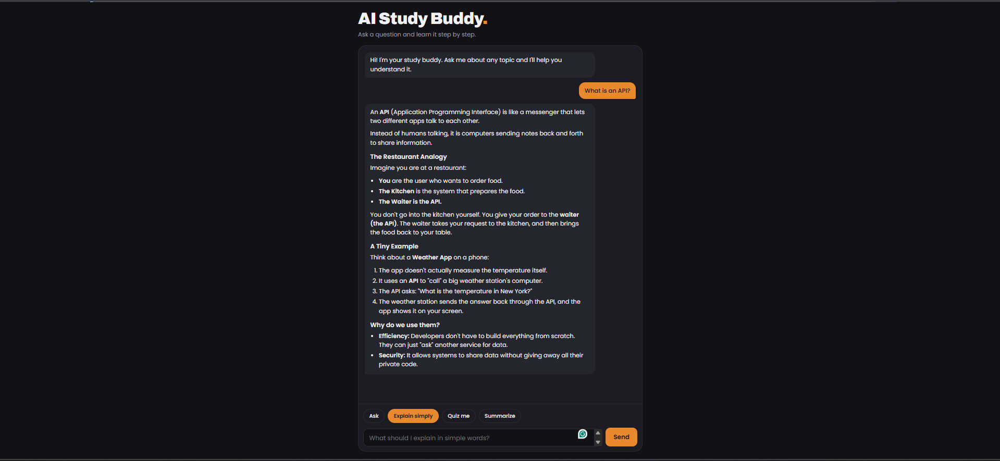

# AI Study Buddy

A mobile-friendly AI study assistant. Ask a question, get a clear answer, or switch modes to be quizzed or to summarize your notes.

The page talks to a small **Node.js + Express** server, and the server talks to the **Google Gemini API**. The API key lives only on the server, so it never appears in frontend code.

**Live demo:** [https://ai-study-buddy-50f4.onrender.com](https://ai-study-buddy-50f4.onrender.com)

> The demo runs on a free host that sleeps when idle, so the first load can take up to a minute. It also has a daily message cap to protect the free AI quota.



## Features

- **Four study modes:** Ask, Explain simply, Quiz me, and Summarize
- **Conversation memory:** the buddy remembers what you said earlier in the chat
- **Formatted answers:** lists, bold text, and code blocks, cleaned with DOMPurify before showing
- **Loading indicator** and friendly error messages
- **Rate limiting:** 10 messages per minute per visitor, plus a daily cap for the whole app to protect the free quota
- **Mobile friendly** layout with light and dark mode that follows your device settings
- **Safe API key handling:** the key stays in a `.env` file on the server and is never committed

## Tech stack

- **Frontend:** HTML, CSS, and vanilla JavaScript
- **Backend:** Node.js and Express
- **AI:** Google Gemini API (`@google/genai`)
- **Extras:** `express-rate-limit`, `dotenv`, `marked`, `DOMPurify`
- **Hosting:** Render (free tier)

## How it works

```
Browser  →  POST /api/chat  →  Express server  →  Gemini API
   ↑                                   |
   └────────────── reply ──────────────┘
```

The browser sends your message, the earlier conversation, and the chosen mode to the server. The server checks the input, applies rate limits, adds the tutor instructions for that mode, and calls Gemini with the secret key. Only the reply goes back to the browser.

## Run it locally

You need [Node.js](https://nodejs.org) 18 or newer and a free Gemini API key from [Google AI Studio](https://aistudio.google.com).

1. Clone the repo and open the folder:
   ```
   git clone https://github.com/KelshRyleMaranan/ai-study-buddy.git
   cd ai-study-buddy
   ```
2. Install the dependencies:
   ```
   npm install
   ```
3. Create your own `.env` file from the example:
   ```
   copy .env.example .env
   ```
   Then open `.env` and put your key after `GEMINI_API_KEY=`.
4. Start the server:
   ```
   npm start
   ```
5. Open http://localhost:3000

## Environment variables

| Name | Required | Description |
| --- | --- | --- |
| `GEMINI_API_KEY` | Yes | Your key from Google AI Studio |
| `GEMINI_MODEL` | No | Gemini model to use (default: `gemini-3-flash-preview`) |
| `DAILY_LIMIT` | No | Total chats allowed per day for the whole app (default: `200`) |

## Deployment

The app is deployed as a Node web service on Render. The build command is `npm install`, the start command is `npm start`, and the environment variables above are set in the Render dashboard, never in the code.

## Project structure

```
ai-study-buddy/
├── public/
│   ├── index.html    # chat page
│   ├── style.css     # styles (light and dark mode)
│   └── script.js     # chat behavior
├── imgs/             # screenshots for this README
├── server.js         # Express server and Gemini call
├── .env.example      # example settings (no real key)
└── package.json
```

## Author

**Kelsh Ryle Maranan**

- Portfolio: [kelshrylemaranan.github.io](https://kelshrylemaranan.github.io)
- GitHub: [@KelshRyleMaranan](https://github.com/KelshRyleMaranan)
- LinkedIn: [Kelsh Ryle Maranan](https://www.linkedin.com/in/maranan-kelsh-ryle-815673447/)